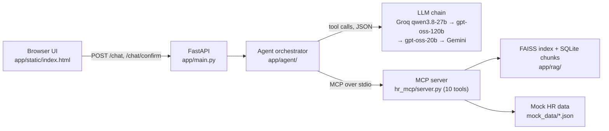

# HR Policy Agent

An HR policy assistant for a fictional company. It answers policy questions with citations from a
12-document corpus (RAG), checks the user's own records and eligibility through 10 tools on a
real MCP server, drafts emails, and proposes HR tickets that are created only after the user
clicks Confirm. Built for Quantic MSAIE Project 3.

- **Deployed app:** _TBD after P8_ (see [deployed.md](deployed.md))
- **Design and evaluation:** [design-and-evaluation.md](design-and-evaluation.md)
- **Evaluation report:** [evaluation/report.md](evaluation/report.md)
- **How AI tools were used:** [ai-tooling.md](ai-tooling.md)

All policies and employee records are synthetic and AI-assisted, written for this project. They
describe no real employer or person. Two public-domain US government documents (NIST SP 800-46r2
excerpt, OPM annual leave fact sheet) are included as external references; see
[app/data/policies/SOURCES.md](app/data/policies/SOURCES.md).

## Architecture



The orchestrator is a hand-written tool-calling loop (no agent framework). Guardrails run before
the model (out-of-scope, emergency, legal and sensitive topics) and after it (citations must come
from this turn's tool results; employee tools only accept the employee picked in the UI). Dates and
PTO arithmetic are computed by the rules engine in `hr_mcp/rules.py`, not by the model.

## Run locally

Requires Python 3.13.

```bash
python -m venv .venv
.venv\Scripts\activate            # macOS/Linux: source .venv/bin/activate
pip install -r requirements-dev.txt
copy .env.example .env            # then add GROQ_API_KEY and GEMINI_API_KEY (both free tiers)
python -m app.rag.ingest --embedder all    # builds app/data/index/{gemini,tfidf}
uvicorn app.main:app --reload     # http://127.0.0.1:8000
```

Without any key the app still starts: `/health` reports `degraded` and retrieval uses the keyless
TF-IDF index. There is also a terminal chat: `python -m app.agent.chat --employee E-1002`.

### Environment variables

| Variable | Default | Purpose |
|---|---|---|
| `GROQ_API_KEY` | (none) | Main LLM provider (free tier) |
| `GROQ_MODEL` | `qwen/qwen3.8-27b` | First model tried |
| `GROQ_FALLBACK_MODELS` | `openai/gpt-oss-120b,openai/gpt-oss-20b` | Each Groq model has its own per-minute token budget |
| `GEMINI_API_KEY` | (none) | Embeddings, last-resort LLM, evaluation judge |
| `GEMINI_MODEL` | `gemini-3.8-flash` | Last-resort LLM |
| `JUDGE_MODEL` | `gemini-3.5-flash-lite` | Evaluation judge (separate free-tier quota) |
| `EMBEDDING_BACKEND` | `gemini` | `gemini` or `tfidf`; falls back to `tfidf` if the Gemini index is unusable |
| `INDEX_DIR` | `app/data/index` | Where `app.rag.ingest` writes the indexes |
| `VECTOR_TOP_K` | `4` | Chunks returned per search |
| `AGENT_MAX_STEPS` | `8` | Model calls per turn, including the final answer |
| `REFERENCE_DATE` | today | Pin "today" (YYYY-MM-DD) for reproducible date rules |
| `SEED` | `42` | Sent to Groq for repeatable sampling |
| `MOCK_DATA_DIR` | `mock_data` | Synthetic employee, PTO, benefits and ticket data |

## Endpoints

| Endpoint | Purpose |
|---|---|
| `GET /` | Chat UI with an "Acting as" picker and a 27-question library |
| `POST /chat` | `{message, session_id?, employee_id?}` → answer, facts, recommendations, citations, tool trace, status |
| `POST /chat/confirm` | `{session_id, token, approve}` creates or cancels a proposed ticket |
| `GET /health` | Status, MCP connection and tool count, LLM providers, index build info |
| `GET /tools` | Live `tools/list` from the MCP server |
| `GET /employees`, `GET /demo-tasks` | Picker data and the question library |
| `GET /eval/latest` | Headline numbers from the newest committed evaluation results |

## Demo tasks

In the UI, pick the employee and click the question in the left panel, or use curl:

```bash
# 1. Remote work abroad -> needs review; a ticket is proposed, created only on Confirm
curl -s localhost:8000/chat -H "content-type: application/json" -d "{\"employee_id\":\"E-1001\",\"message\":\"Can I work from Mexico City for 6 weeks starting January 11, 2027? If it needs a review, open a ticket.\"}"

# 2. PTO request -> allowed with manager approval; email drafted, not sent
curl -s localhost:8000/chat -H "content-type: application/json" -d "{\"employee_id\":\"E-1002\",\"message\":\"Can I take 3 days of PTO starting Monday November 9? If yes, draft an email to my manager.\"}"
```

The full question list with expected results is in [docs/demo-questions.md](docs/demo-questions.md).

## Tests and evaluation

```bash
ruff check .
pytest -q                                   # 90 tests, no API key or network needed
python -m evaluation.run_eval --retrieval-only          # top-k x embedder ablation, no LLM
python -m evaluation.run_eval                           # 28 cases, ~30 s apart (free-tier limits)
python -m evaluation.run_eval --mode rag_only --cases W01,W02,W03,W04,W05,W06,W07,W08
python -m evaluation.latency_probe https://<app>.onrender.com   # cold start, ~50 min
```

Results go to `evaluation/results/` and `evaluation/report.md` is regenerated.

## CI/CD and deployment

GitHub Actions (`.github/workflows/ci.yml`) runs on every push and pull request: lint, import
check, keyless index build, the test suite, the retrieval ablation and a smoke test that starts the
app and requires `/health` to show the MCP server connected. On `main` only, and only after those
pass, the `deploy` job calls the Render deploy hook and waits for the new instance's `/health`.
Render's own auto-deploy is off (`render.yaml`), so CI is the only path to production.

Render free tier: the service sleeps after 15 minutes idle, and the first request after that
takes about a minute. A `Dockerfile` is included as a portable alternative.

## Security

- Keys come from environment variables only; `.env` is git-ignored.
- The LLM never sees the ticket confirmation token; only the user's Confirm click sends it.
- Model output is rendered with `textContent`, never as HTML.
- Users can only read their own records (the employee picked in the UI).
