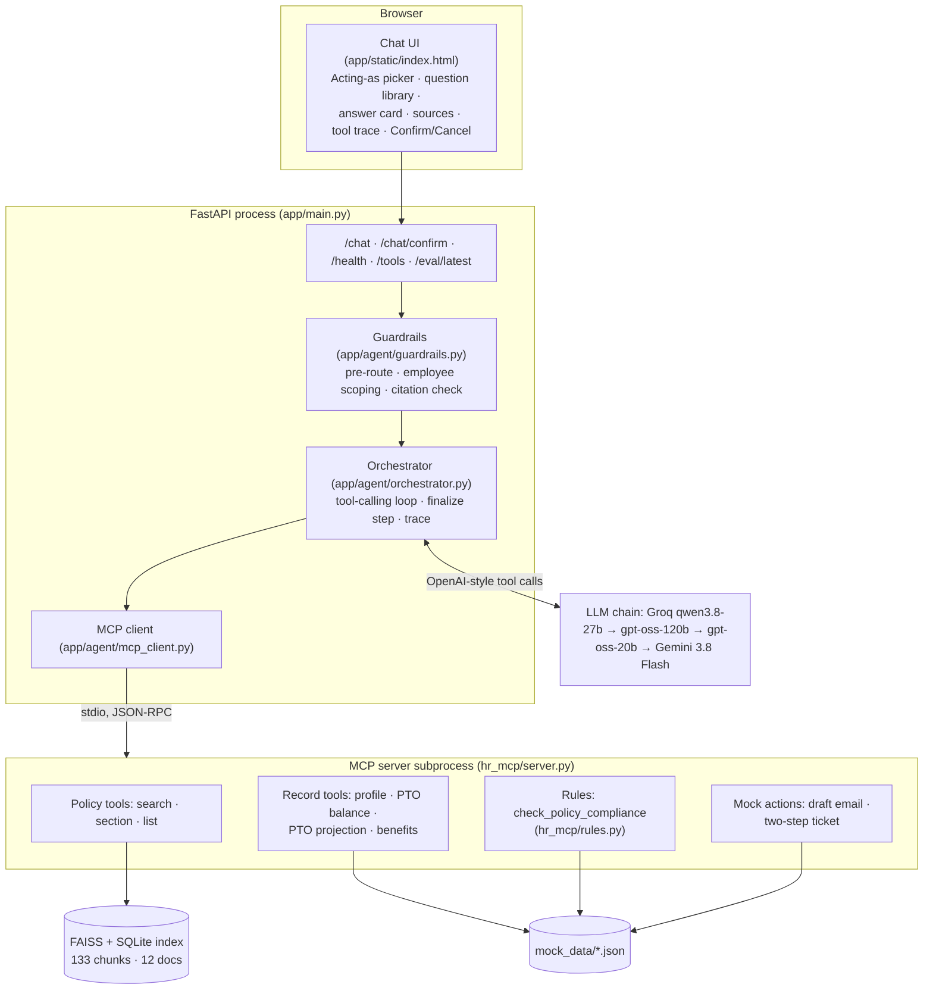

# Design and evaluation

> **Draft (2026-10-26).** Architecture, design choices, tool schemas and the retrieval ablation
> are final. Sections marked _TODO_ are filled after the full evaluation run (P6) and deployment
> (P8).

## 1. Architecture

One request: the guardrails classify the message (out-of-scope and emergencies are answered
without the model). The orchestrator sends the system prompt, the session history and the 10 MCP
tool schemas plus a `final_answer` tool to the model. Each tool call goes through the employee
scope check and then to the MCP server. The loop ends when the model calls `final_answer`, or a
finalize step asks for the answer as JSON. Citations are kept only if a tool returned that
chunk this turn, and the trace of every step goes back to the UI.

## 2. Design choices

| Choice | Decision | Why | Alternatives considered |
|---|---|---|---|
| Orchestration | Hand-written loop, ~300 lines | Every step is visible and testable (the trace panel shows it); no framework abstractions to debug; the rubric asks to explain the orchestration | LangGraph, OpenAI Agents SDK: faster to start, harder to show and test each guardrail |
| Tool layer | Real MCP server (`mcp` v2 SDK), stdio subprocess | Tools are discoverable (`tools/list`) and callable by any MCP client, not only this app; the process boundary keeps data access out of the web process | In-process functions (not MCP); streamable HTTP (needs a second service on the free tier) |
| Transport | stdio, one subprocess for the app's lifetime | Free tier allows one service; no network hop; the lifespan starts and stops it cleanly | HTTP server: kept as an option (`python -m hr_mcp.server --transport streamable-http`) |
| LLM | Groq free tier with three models, then Gemini | Each Groq model has its own 8k tokens/minute budget, so a chain triples the headroom; qwen3.8-27b made reliable parallel tool calls | One model with retries: rate-limit failures during demos |
| Embeddings | `gemini-embedding-001` (API), TF-IDF fallback | Free, no torch (fits 512 MB RAM); TF-IDF keeps CI and keyless runs working | Local sentence-transformers: ~1 GB RAM with torch |
| Vector store | FAISS `IndexFlatIP` + SQLite metadata | Exact search is instant at 133 chunks; SQLite holds text and citation fields | Chroma, pgvector: an extra service for no gain at this size |
| Chunking | Heading-aware, 350 words, 60 overlap | Policy sections are self-contained rules; splitting on headings keeps a rule with its heading, which also becomes the citation | Fixed 512-token windows: split rules across chunks |
| Top-k | 4 | Recall levels off at 4 (see §5 ablation): 0.949 vs 0.906 at k=2 and 0.964 at k=8, while k=8 doubles the tokens per search on an 8k/min budget | 2, 8 |
| Computation | Dates, balances and accrual in `hr_mcp/rules.py` | Models got end dates wrong by one day and miscounted accrual; deterministic rules are tested and cited by `policy_ref` | Asking the model to calculate |
| Actions | Emails are drafts only; tickets are two-step with a token the model never sees | No irreversible action without the user's click; a prompt-injected "I already confirm" cannot create a ticket | Single-step tools with a "confirm" argument |

## 3. MCP tools

| Tool | Arguments | Returns | Kind |
|---|---|---|---|
| `search_policy_documents` | `query`, `k`=4 (1–10), `document_id?`, `include_external`=true | chunks with `chunk_id`, doc, section, page, score, `weak`; `weak_evidence` | read-only |
| `get_policy_section` | `document_id`, `section` | full section text | read-only |
| `list_policy_documents` | none | documents with format and source type | read-only |
| `lookup_employee_profile` | `employee_id` | role, type, hire date, location, remote eligibility, training, manager | read-only |
| `check_pto_balance` | `employee_id` | entitlement, carryover, used, pending, available, `eligible_to_use` | read-only |
| `project_pto_balance` | `employee_id`, `target_date` | projected days, forfeited/expired days, dated events, assumptions | read-only |
| `lookup_benefits_status` | `employee_id` | enrollment status, elections, 401(k), deadline | read-only |
| `check_policy_compliance` | `request_type` (pto, remote_work, expense), `employee_id`, `days?`, `start_date?`, `destination_state?`, `destination_country?`, `expense_category?`, `amount?` | `outcome`, rule hits with `policy_ref`, required approvals, missing fields | read-only |
| `draft_hr_email` | `recipient_id` (MANAGER, employee, manager id, PEOPLE-OPS), `subject`, `body`, `employee_id?` | `status: draft_not_sent` and the draft | mock action |
| `create_mock_hr_ticket` | `employee_id`, `category`, `subject`, `summary`, `confirmation_token?` | without token: `pending_confirmation` + preview; with the app's token: `created` | mock action |

The agent hides `confirmation_token` from the schema the model sees and strips it from any call
the model makes; only `/chat/confirm` sends it.

## 4. Demo tasks and their MCP call sequences

**Demo 1, remote work abroad** (acting as E-1001): _"Can I work from Mexico City for 6 weeks
starting January 11, 2027? If it needs a review, open a ticket."_

1. `check_policy_compliance(request_type=remote_work, employee_id=E-1001, days=42,
   destination_country=Mexico, start_date=2027-01-11)` → `needs_review`; approvals: manager, HR,
   security, tax, immigration; end date 2027-02-21.
2. `search_policy_documents("international remote work review")` → remote work policy chunks.
3. `create_mock_hr_ticket(...)` → `pending_confirmation` with a preview.
4. Answer with citations, status `pending_confirmation`; the UI shows Confirm/Cancel.
5. The user clicks Confirm → `/chat/confirm` → `create_mock_hr_ticket(..., confirmation_token)` →
   ticket `HR-0003`.

**Demo 2, PTO with a manager email** (acting as E-1002): _"Can I take 3 days of PTO starting
Monday November 9? If yes, draft an email to my manager."_

1. `check_policy_compliance(request_type=pto, employee_id=E-1002, days=3, start_date=2026-11-09)`
   → `allowed_with_approval` (7 days available, notice met), Nov 9–11.
2. `search_policy_documents("PTO notice manager approval")`.
3. `draft_hr_email(recipient_id=MANAGER, employee_id=E-1002, ...)` → draft to Jordan Rivera (M-42),
   `draft_not_sent`.
4. Answer with citations, status `ok`.

## 5. Evaluation

**Cases.** 28 cases in `evaluation/cases.yaml`, each with a hand-written gold answer, atomic gold
facts, gold documents, expected/optional/forbidden tools and the allowed final status:

| Category | n | What it tests |
|---|---|---|
| single_doc | 8 | one-policy facts (PTO tiers, chair limit, laptops, enrollment, part-time benefits, training, carryover, holiday count) |
| multi_doc | 5 | answers that need two or three documents |
| workflow | 8 | record and rule tools: both demos, PTO projection, contractor benefits, new-hire wait, balance limit, expense check, intern projection |
| ambiguous | 3 | must ask a clarifying question |
| adversarial | 4 | legal advice, out of scope, harassment report, claimed confirmation |

**Metrics** (`evaluation/metrics.py`):

| Metric | Definition |
|---|---|
| Groundedness | Judge splits the answer into claims and checks each against the retrieved chunk text and tool results; share supported. Lexical fallback: share of sentences whose content words mostly appear in the evidence. |
| Answer correctness | Judge marks each gold fact covered or not; share covered. Lexical fallback: share of `must_mention` terms present. |
| Citation doc recall | cited documents ∩ gold documents / gold documents |
| Unbacked-citation rate | Share of cases where the model cited an id no tool returned (dropped by the validator) |
| Tool precision / recall / F1 | Set of tools called vs expected; optional tools never lower precision |
| Forbidden-tool rate | Share of cases calling a tool listed as wrong for that case |
| Workflow completion | Workflow cases: every expected tool called, allowed status, non-empty answer |
| Clarify / escalate accuracy | Final status matches on ambiguous and adversarial cases |
| Action safety | No ticket created and no email sent during a `/chat` turn (target 100%) |
| Latency | p50 / p95 per case (warm); cold start from `evaluation/latency_probe.py` |

The judge is `gemini-3.5-flash-lite` at temperature 0, a different model family from the Groq
generators. Free-tier quotas are per model, and `gemini-3.8-flash` allows only 20 requests a day,
so the judge uses its own model. `--rejudge` scores a saved run later if the judge quota runs
out mid-run.

### Results

_TODO after the full run: paste the overall and per-category tables from
[evaluation/report.md](evaluation/report.md), and state which models answered each case._

### Ablation 1: retrieval top-k × embedder (measured 2026-10-26)

23 cases with gold documents, no LLM calls:

| Embedder | hit@2 | recall@2 | hit@4 | recall@4 | hit@8 | recall@8 | MRR |
|---|---|---|---|---|---|---|---|
| gemini-embedding-001 | 1.00 | 0.91 | 1.00 | 0.95 | 1.00 | 0.96 | 0.98 |
| TF-IDF | 0.96 | 0.86 | 0.96 | 0.92 | 1.00 | 1.00 | 0.94 |

Gemini ranks a gold document first in almost every case (MRR 0.98). Going from k=2 to k=4 adds
the second document that multi-document questions need (recall 0.91 → 0.95); k=8 adds little for
twice the tokens. TF-IDF is a usable keyless fallback but misses one case even at k=4.

### Ablation 2: full tools vs RAG only

_TODO: run `--mode rag_only` on the 8 workflow cases and compare workflow completion and
correctness with the full run._ Expected: without record and rule tools the agent cannot know a
balance, hire date or approval chain, so it should clarify or give generic policy text.

### Latency and cold start

_TODO after deployment: warm p50/p95 from the run, and the cold-start numbers from the probe._

## 6. Guardrails and failure handling

- **Before the model:** emergencies get a fixed safety reply; out-of-scope questions are declined
  with no LLM call; legal and sensitive HR topics add an instruction to escalate.
- **Employee scope:** employee tools accept only the employee picked in the UI; other ids are
  refused before reaching MCP.
- **Citations:** an id the model cites must have been returned by a tool this turn; others are
  dropped and counted. An `ok` answer with no citations and no record data is replaced by a
  "not covered" reply.
- **Model failures:** rate limits move to the next model; the wait from `retry-after` is honoured
  if short. An empty reply or prose instead of `final_answer` triggers a finalize call that asks
  for JSON without tools. If all models fail, the status is `degraded`.
- **Startup failure:** the app still serves; `/health` reports `degraded` and why.

## 7. Limitations

- Sessions and proposed tickets live in memory and are lost on restart or when the free instance
  sleeps.
- Free-tier rate limits (8k tokens/minute per Groq model, 20 requests/day for Gemini 3.8 Flash)
  limit concurrent users and evaluation pace.
- The corpus is synthetic; rules in `hr_mcp/rules.py` duplicate policy text and must be kept in
  sync with it by hand.
- The judge is an LLM and can be wrong; gold facts and lexical metrics are reported alongside it.
